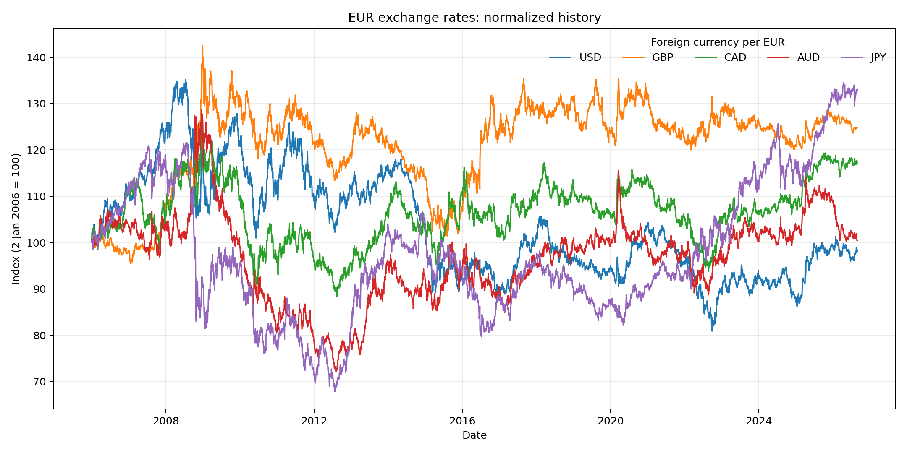
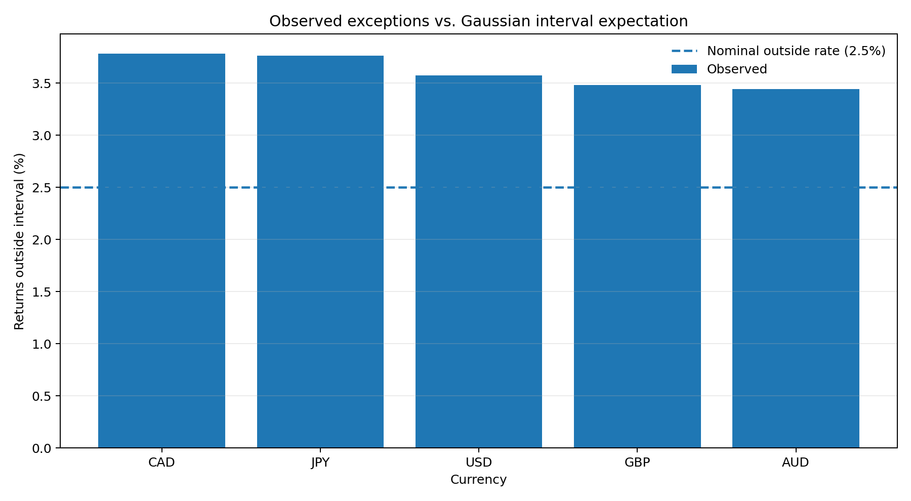
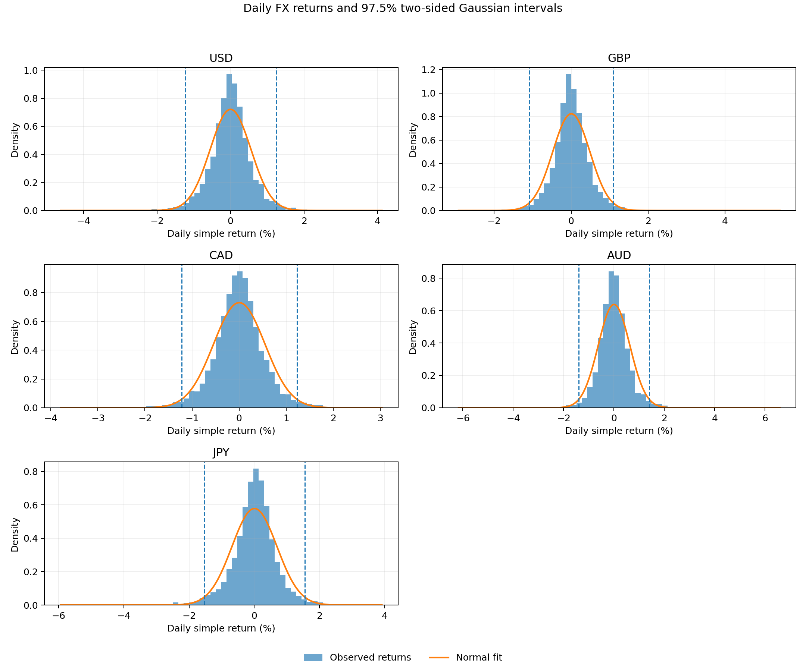

# FX Exchange-Rate Forecasting & Value-at-Risk Analysis

A reproducible Python project that studies daily EUR exchange rates against five major currencies, forecasts one-day-ahead exchange-rate changes with an AR(1) model, and evaluates a Gaussian return-risk interval.


## Research questions

1. Do yesterday's exchange-rate returns help explain today's returns in a simple AR(1) model?
2. What is the one-step-ahead return and exchange-rate forecast for each currency?
3. How often do historical returns fall outside a 97.5% two-sided Gaussian interval?
4. Does the observed exception rate match the 2.5% outside rate implied by that interval?

## Scope and data

- **Currencies:** USD, GBP, CAD, AUD and JPY.
- **Quote convention:** foreign-currency units per EUR (for example, USD per EUR).
- **Period:** 2 January 2006 to 31 August 2026.
- **Observations:** 5,288 daily exchange-rate observations and 5,287 simple daily returns per currency.
- **Input:** [`data/exchange_rates.csv`](data/exchange_rates.csv).

The exchange-rate data is sourced from **Suomen Pankki (Bank of Finland)**. The Bank of Finland's exchange-rate page explains that these are euro reference rates published by the European Central Bank (ECB). See [`data/README.md`](data/README.md) for the source links and data notes.

## Methodology

### 1. Daily returns

For each currency, the project calculates simple percentage changes:

\[
r_t = \frac{S_t-S_{t-1}}{S_{t-1}}
\]

where \(S_t\) is the number of foreign-currency units per euro on date \(t\).

### 2. AR(1) exchange-rate forecasting

The model is estimated separately for each currency:

\[
r_t = \alpha + \beta r_{t-1} + \varepsilon_t
\]

Ordinary least squares (OLS) estimates the intercept and lag coefficient. The next return is forecast as:

\[
\widehat r_{t+1}=\widehat\alpha+\widehat\beta r_t
\]

The forecast exchange-rate level is:

\[
\widehat S_{t+1}=S_t(1+\widehat r_{t+1})
\]

The implementation uses the next weekday as the forecast date. It does not adjust for national or ECB holidays.

### 3. Gaussian return interval and exceptions

The project reproduces the spreadsheet's **97.5% two-sided central normal interval**:

\[
[\bar r-z_{0.9875}s_r,\;\bar r+z_{0.9875}s_r]
\]

where \(\bar r\) and \(s_r\) are the full-sample mean and sample standard deviation of daily returns. The corresponding z-score is approximately 2.2414. The lower and upper return bounds are translated into exchange-rate levels using the last observed spot rate.

The realized exception rate is the number of observed returns outside the interval divided by the number of daily returns. Under the assumed normal distribution, the expected outside fraction is 2.5%.

**Important terminology:** this is a two-sided 97.5% interval, with 1.25% in each tail. It is not the conventional one-tailed 97.5% VaR measure, which allocates 2.5% to one loss tail. It is also not a monetary portfolio VaR calculation: the analysis does not model a portfolio position, notional exposure or P&L. The interval is included as a VaR-style FX return-risk measure and is labelled explicitly to distinguish it from conventional one-tailed portfolio VaR.

## Headline findings

The results produced from the included dataset show:

- The AR(1) lag coefficient is statistically insignificant at the 5% level for all five currency pairs. In this simple in-sample model, the previous day's return does not provide statistically reliable linear predictive information about the current return.
- Observed in-sample exceptions range from approximately **3.44% to 3.78%**, above the **2.50%** nominal outside rate implied by the Gaussian interval.
- This suggests that a constant-volatility normal interval understates the frequency of tail observations in this sample.

These are descriptive, in-sample findings. They do **not** establish market efficiency or prove that the same misspecification will persist out of sample.

## Visual results

**Normalized exchange-rate history**



**Observed exceptions compared with the nominal Gaussian interval rate**



**Daily return distributions and Gaussian intervals**



## Repository structure

```text
fx-forecasting-var/
├── data/
│   ├── exchange_rates.csv
│   └── README.md
├── figures/                         # Generated charts
├── reports/                         # Generated written summary
├── results/                         # Generated CSV tables
├── src/fxrisk/
│   ├── __init__.py
│   ├── analysis.py
│   └── cli.py
├── tests/
│   └── test_analysis.py
├── run_analysis.py
├── requirements.txt
├── pyproject.toml
├── LICENSE
└── README.md
```

## Run locally

Requires Python 3.10 or newer.

### 1. Clone the repository

```bash
git clone https://github.com/YOUR-USERNAME/fx-forecasting-var.git
cd fx-forecasting-var
```

### 2. Create and activate a virtual environment

**Windows PowerShell**

```powershell
py -m venv .venv
.\.venv\Scripts\Activate.ps1
```

**macOS / Linux**

```bash
python3 -m venv .venv
source .venv/bin/activate
```

### 3. Install dependencies

```bash
python -m pip install --upgrade pip
pip install -r requirements.txt
```

### 4. Run the analysis

From the repository root:

```bash
python run_analysis.py
```

To use a different two-sided confidence level or input file:

```bash
python run_analysis.py --confidence 0.95 --input data/exchange_rates.csv
```

### 5. Run the tests

```bash
pytest
```

## Generated outputs

After running the script, the repository contains:

- `results/currency_summary.csv` — forecasts, volatility, Gaussian interval bounds and exception counts.
- `results/ar1_regression_results.csv` — AR(1) coefficients, p-values, R-squared and residual standard errors.
- `figures/normalized_exchange_rates.png` — normalized historical rate paths.
- `figures/return_distributions.png` — return distributions with fitted Gaussian intervals.
- `figures/exception_rates.png` — observed exception rates compared with the nominal 2.5% rate.
- `reports/analysis_summary.md` — generated interpretation and currency-level summary.

## Limitations and possible extensions

- The AR(1) regressions are estimated in-sample. A walk-forward or holdout evaluation is needed to measure genuine forecast performance.
- Volatility is estimated using a constant full-sample standard deviation. GARCH or rolling-volatility models could capture volatility clustering.
- The Gaussian interval assumes normally distributed returns; fat tails and skewness may affect risk estimates.
- The current exception analysis is in-sample, not a formal out-of-sample VaR backtest. A stronger extension would use rolling VaR forecasts and standard backtesting tests such as Kupiec's unconditional coverage test and Christoffersen's independence test.
- The fixed dataset should be refreshed from a verified source before future use.

## Disclaimer

This project is for educational and portfolio-demonstration purposes only. It is not investment advice, a trading recommendation or a production risk-management system.

## License

The analysis code is released under the MIT License. See [`LICENSE`](LICENSE). Review the provenance and reuse terms of the underlying exchange-rate data before redistributing the dataset.
